<div align="center">

# Video Studio

**Turn a product brief into a branded, narrated, animated and fact-checked marketing video, entirely on your Mac.**
Local AI, multiple brands, and a person approving every step that matters.

&nbsp;&nbsp;
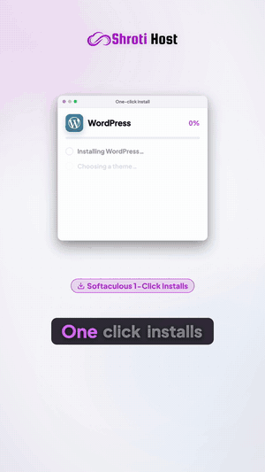

<sub>A real output: a 36.7 s YouTube Short for Shroti Host WordPress Hosting, made from a 10-line brief.
The voice, captions, music, animation and QA all ran locally; a person approved it before it was published.
**[▶ Watch it on YouTube](https://youtube.com/shorts/mGSbWJHqiXo)**</sub>

[](https://youtube.com/shorts/mGSbWJHqiXo)


</div>

---

## Why

Short-form product video usually means an agency retainer, or a SaaS tool that sends your briefs, scripts and voice
to someone else's servers. This studio does the whole job on one laptop, at no running cost.

| | |
|---|---|
| 🔒 **Private** | Briefs, narration, voice and assets stay on the machine. It is designed to run fully offline; the only online features (publishing, keyword research, an optional online voice) are opt-in. |
| ✅ **Accurate** | Every price, plan, spec and URL shown or spoken is checked against a fact base verified on the brand's own website. |
| 🎬 **Designed, then checked** | Professionally composed scene templates own layout and animation. An opt-in component generator designs new scene graphics, scored by the same layout, sync and fact rules. AI drafts copy only inside validated slots. |
| 🧑‍⚖️ **Accountable** | No expensive render, approval or publish happens without a named person's decision, bound to the exact files by SHA-256. |
| 🏷️ **Multi-brand** | One studio for many websites. Each brand's logos, facts, voice and social accounts are strictly isolated. |

## Results

### The final video

| Measure | Result |
|---|---|
| Format | 1080×1920, 30 fps, H.264 / BT.709, −14 LUFS mastered audio |
| Length | 36.7 s; 7 scenes, each with a hero visual |
| Automated QA | **43 / 43 PASS**: structure, decode, loudness, captions, layout, OCR of prices and URLs, branding |
| Audio ↔ picture | **0 ms** measured offset, 0 ms drift |
| Narration ↔ visuals | a visual event at least every 2.5 s of speech; no price shown before it is spoken |
| Facts | 0 unverified claims; WP Starter ₹69 and WP Business ₹119 verified on the brand's site |
| Delivery | approved by a named reviewer, uploaded to the brand's YouTube channel, then made public: **[watch it](https://youtube.com/shorts/mGSbWJHqiXo)** |

<p align="center">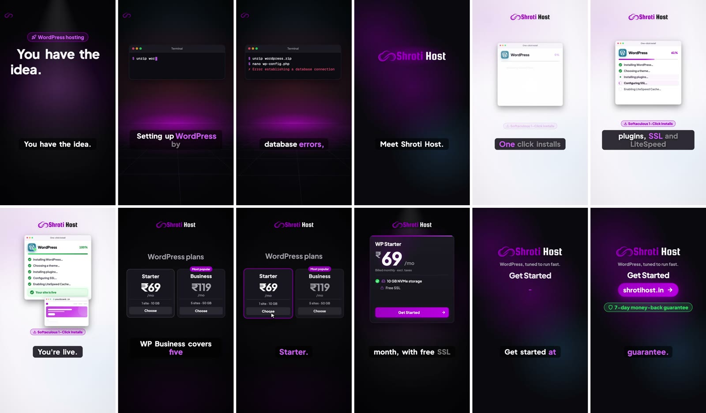</p>

### Before → after

The first version let the AI design every scene. It passed technical QA, but it was creatively weak:
- the AI placed every block, so half the frames were empty;
- it invented UI labels like "Browser: 39 rupees";
- the voice ran over a frozen screen.

The fix was a hybrid engine; the [same-brief comparison](docs/reports/CREATIVE_COMPARISON.md) has the details.

<table>
<tr><th>Before: the LLM placed every block</th><th>Now: hybrid templates + verified facts</th></tr>
<tr><td>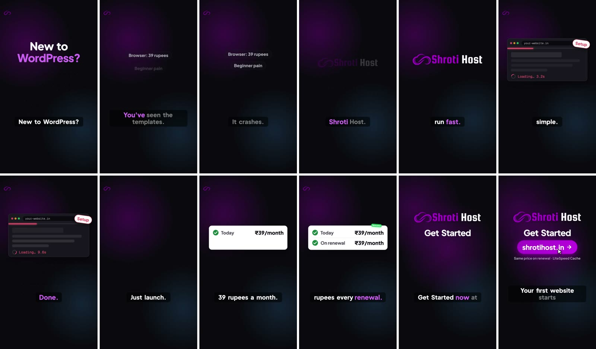</td>
<td></td></tr>
</table>

| Same brief, measured | First AI-only version | Hand-built style | **Hybrid engine (shipped)** |
|---|---|---|---|
| Storyboard quality gate | ❌ FAIL (5 checks) | ⚠️ WARN | ✅ **PASS** |
| Frames that are essentially empty | 51.4 % | 24.3 % | 29.7 % |
| Visual change between frames | 4.1 | 8.2 | **17.7** |
| Blocks per scene | 1.5 | 2.3 | 2.0 |
| Premium scene components | none | none | install flow, plan card, terminal, logo sting, kinetic type, outro |
| Backdrops / camera moves | 1 / 0 | 1 / 0 | **5 / 5** |
| Unverified claims · clichés | 7 · "No tech skills" | 0 · none | **0 · none** |

## Video Studio Created Its Own Launch Video

The launch film for this repository was produced with Video Studio itself, through the same pipeline and approval
gates as any other video. It runs 96 seconds, in 9:16 and 16:9.

<p align="center"><a href="https://lnkd.in/p/gTd-psxr"></a></p>
<p align="center"><b><a href="https://lnkd.in/p/gTd-psxr">▶ Watch the launch film on LinkedIn</a></b></p>
<p align="center">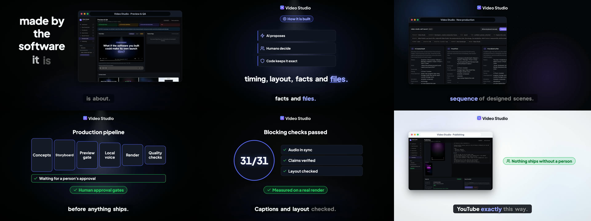</p>

- **Made in the Studio.** The brief went in through the Studio's New Production form. The hybrid engine drafted
  three concepts, and the storyboard, preview gate, render, QA and approval all ran in the app.
- **Real footage only.** Every screen in the film is a recording of the running Studio, made with
  `scripts/capture_studio.mjs`. That includes this film's own storyboard and preview, and the Studio playing an
  earlier cut of it.
- **New components.** The architecture, pipeline, stack and QA scenes use designs the component generator created
  for this film. Each one scored at least as well as the template it replaced on layout, sync and legibility.
- **Its own QA.** The film states the result of its own check: 31 of 31 blocking QA checks passed in both formats.
  The audio is mastered to −14.2 LUFS with a 0 ms audio/video offset.
- **Bugs it found.** Making the film exposed pipeline bugs, now fixed with tests:
  - preview approval refused any storyboard with footage;
  - QA read the words "Remotion renderer" as a watermark;
  - scenes opened on a bare backdrop;
  - QA passed its OCR checks when the OCR engine itself had failed.
- **A person approved it.** The reviewer watched and listened to it in both formats and recorded approval
  (hash-bound), then posted it on LinkedIn: **[watch the launch film](https://lnkd.in/p/gTd-psxr)**.

The full record, from audit and iterations to scores and evidence, is in
[SELF_LAUNCH_AUDIT](docs/reports/SELF_LAUNCH_AUDIT.md),
[SELF_LAUNCH_CREATIVE_REVIEW](docs/reports/SELF_LAUNCH_CREATIVE_REVIEW.md) and
[SELF_LAUNCH_PRODUCTION_EVIDENCE](docs/reports/SELF_LAUNCH_PRODUCTION_EVIDENCE.md).

## How it works

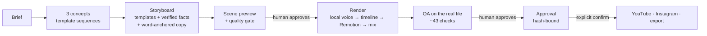

1. **Brief → concepts.** A ten-line JSON brief (product, price, audience, goal, CTA) becomes three distinct concepts.
   Each is a sequence of professionally designed scene templates: hook, problem, reveal, demo, pricing, CTA.
2. **Concept → storyboard.**
   - Templates own composition, animation and every on-screen label.
   - Numbers come only from the brand's verified facts.
   - A local LLM (Qwen3-4B) may draft copy only inside validated slots, with a hand-written copy bank as the fallback.
3. **Preview + quality gate.**
   - One still per scene renders in seconds.
   - The gate rejects empty or repetitive scenes, scenes without a hero visual, invented labels, unverified numbers,
     overflowing text, and narration that runs over a frozen screen.
   - **A person approves the preview before the full render.**
4. **Render.**
   - A local voice (Kokoro) speaks the script; Python resolves every animation to the exact word that names it.
   - Remotion renders in parallel headless Chromium tabs; FFmpeg mixes voice, licensed music and sound effects.
5. **QA on the actual file.** Container, full decode, black or frozen frames, loudness and peaks, caption timing,
   measured A/V offset, narration sync, layout, digit-exact OCR of prices and URLs, and brand presence.
6. **Approval → publishing.**
   - A reviewer approves the exact package (video, captions, title, description, tags).
   - Publishing to YouTube or Instagram is a separate, confirmed step.
   - The upload is refused if the platform account doesn't belong to the video's brand.

> **Principle:** AI proposes, humans decide, and deterministic code owns everything that must be exact: timing,
> layout, facts and file integrity.

## The engine

32 animated block types and 6 backdrops (glow, spotlight, grid, split, light, deep). Every block works in 9:16 and 16:9.
Two of them are new: `footage` plays real screen recordings in a browser, laptop or phone frame, with word-anchored
zooms; `composition` draws scenes that the component generator designs from primitives (cards, rings, connectors,
icons, counted numbers).

<p align="center">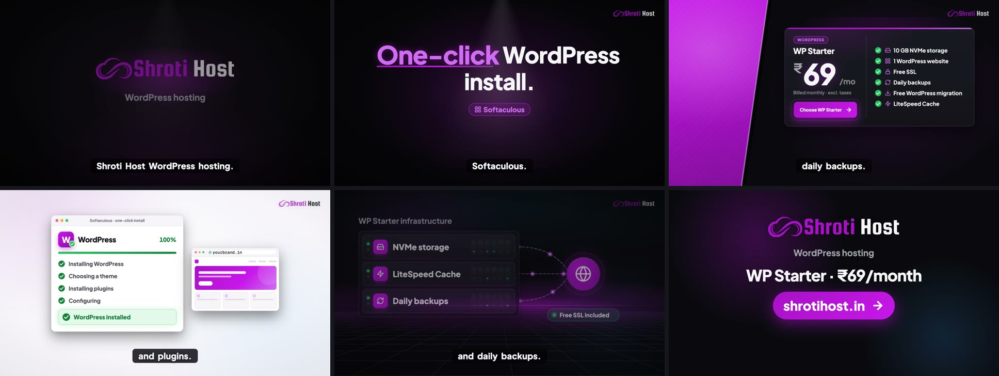</p>
<p align="center">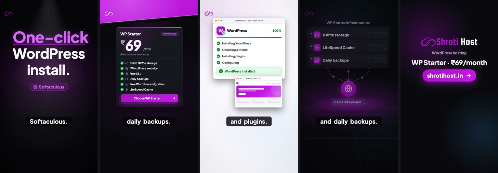</p>

Every visual beat is anchored to a spoken word (`"at": "@word:Starter+0.35"`). So the price card counts up as the
voice says "sixty-nine", and the install completes on "You're live". The **preview gate** checks this on estimated
timings before any voice is recorded:

<p align="center">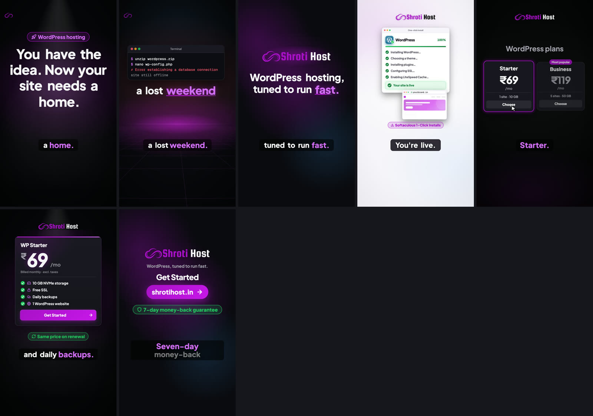</p>

## The Studio

A local web app on `127.0.0.1` covers the whole workflow. It has a brand filter, a "needs your attention" queue,
preview review, QA, approvals and confirmed publishing.

<p align="center">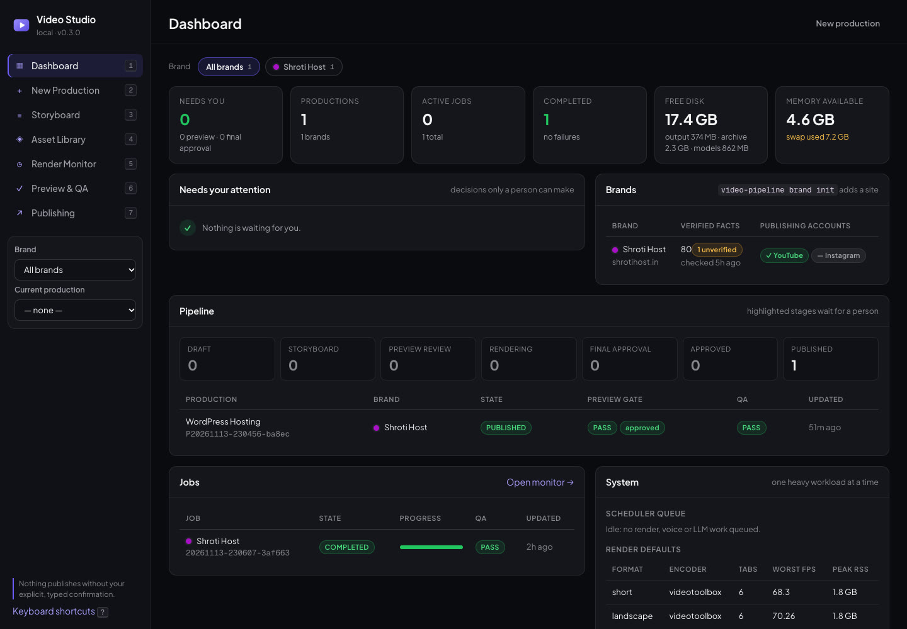</p>

<table>
<tr><td>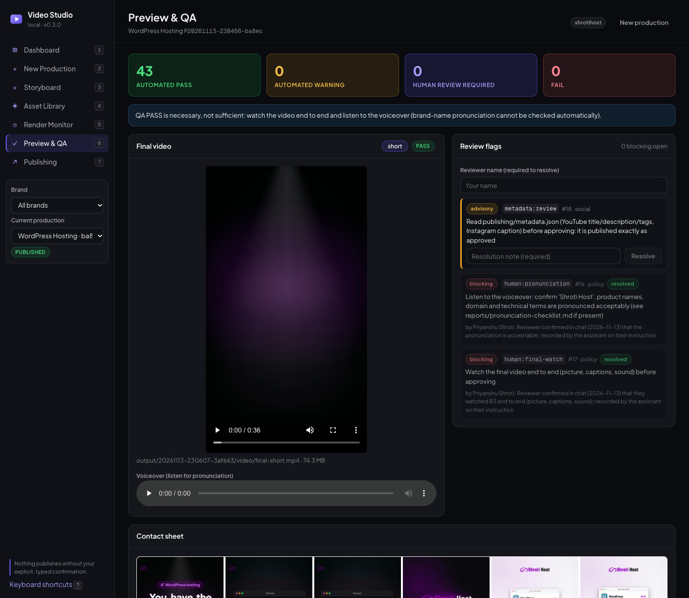</td>
<td>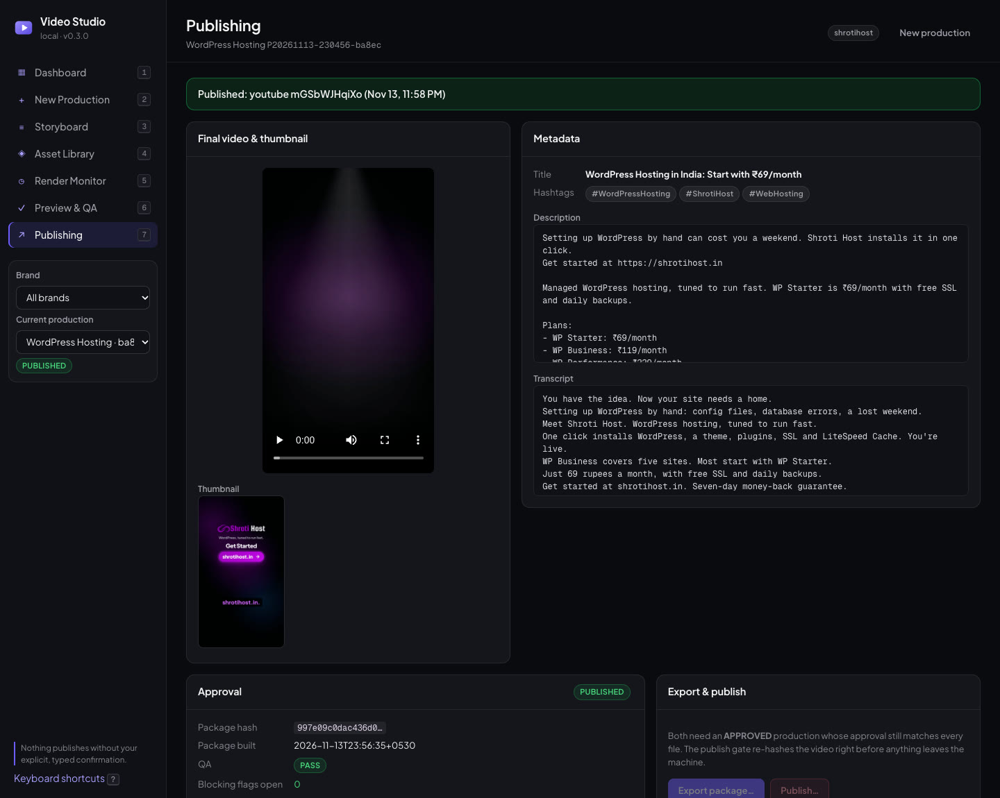</td></tr>
<tr><td align="center"><sub>Preview &amp; QA: automated checks plus the human sign-offs</sub></td>
<td align="center"><sub>Publishing: the approved package and where it went</sub></td></tr>
</table>

## Publishing

The video's shape decides where it goes, from an ffprobe of the real file:

| Video | YouTube | Instagram |
|---|---|---|
| 9:16, ≤ 3 min | Short | Reel |
| 9:16, longer | regular video | Reel (≤ 15 min / 300 MB) |
| 16:9 | regular video with chapters | never; it suggests the 9:16 render |

- **Titles, descriptions, tags and captions** are drafted by the local LLM, or written by a person. Both go through
  the same claim, cliché, length and hashtag checks, and the text is part of the approved package.
- **Accounts are per brand**: credentials live in `.pipeline/secrets/<brand>/` (mode 600). Before any upload, the
  platform's "who am I" answer must match `brand.json → publishing.accounts`.
- **Uploads go to YouTube as private** first. Every upload is recorded with the approver's name and the content hash.
- **Also available as an MCP server** (`uv run video-pipeline-mcp`, stdio) for AI assistants, with read-only tools
  plus publish tools that need explicit confirmation ([setup](docs/SOCIAL_PUBLISHING.md#mcp-server)).

## Multi-brand

```bash
uv run video-pipeline brand list
uv run video-pipeline brand init --id mysite --site https://mysite.com --industry web-hosting
uv run python -m pipeline.intelligence facts --brand mysite --refresh
```

`brand init` drafts a brand from its home page and never invents prices:
- the profile, colors, logo, fonts and pronunciation;
- a fact base whose prices and features enter only once verified against the site.

Each brand gets its own folders:

| Folder | Holds |
|---|---|
| `brands/<id>/` | brand.json, theme.json, assets.json, pronunciation.json |
| `knowledge/<id>/facts.json` | facts, with source URLs |
| `projects/<id>/briefs/` | briefs |
| `.pipeline/secrets/<id>/` | social accounts |
| `video-out/<id>/` | finished videos |

## Quick start

```bash
# install (once)
brew install ffmpeg uv node ollama
npm ci --legacy-peer-deps && npx remotion browser ensure
uv sync
uv run python -m pipeline.voice.registry fetch                      # local voices (~840 MB, checksummed)
uv run python -m pipeline.intelligence runtime start && ollama pull qwen3:4b-instruct-2507-q4_K_M
bash scripts/sound-layer.sh kit && uv run python -m studio.build
uv run video-pipeline doctor
```

```bash
# brief → video
uv run video-pipeline production create   --brief projects/shrotihost/briefs/wordpress-hosting-69.json
P=P2026…                                                    # the production ID printed by create
uv run python -m pipeline.intelligence runtime start
uv run video-pipeline production concepts --id $P          # 3 concepts → concepts/concepts.md
uv run video-pipeline production select   --id $P --concept c1
uv run python -m pipeline.intelligence runtime stop
uv run video-pipeline production preview  --id $P          # scene stills + quality gate
uv run video-pipeline production approve-preview --id $P --reviewer "Your Name"
uv run video-pipeline production render   --id $P --wait   # → video-out/<brand>/for-review/
uv run video-pipeline approve --id $P --reviewer "Your Name"
uv run video-pipeline publish --id $P --platform youtube --actor "Your Name" --confirm
```

To use the Studio instead, run `uv run video-pipeline studio --open`. To keep things tidy, `video-pipeline archive --all-except $P`
hides the rest, and its files move to `output/_archive/` (reversible).

## Performance

Measured on an M1 Pro (16 GB) with other apps running ([benchmark](docs/reports/BENCHMARK_REPORT_V030.md)):

| | |
|---|---|
| Render throughput (1080p, 6 Chromium tabs) | **68–70 fps**, no swapping |
| Brief → video awaiting approval, fully offline | **≈ 4 minutes** |
| Final 36.7 s Short, render + QA | ≈ 1 minute |
| Local voice | ≈ 11 s per Short; speaks 2.37 words/s, which every length estimate is calibrated to |

## Repository layout

```
pipeline/            orchestrator: CLI, productions, jobs, scheduler, timeline, QA, approvals, archive
  creative/          hybrid creative engine: templates, copy bank, rules, component generator (+ industries/ packs)
  intelligence/      local LLM runtime, claim checking, fact base
  social/            YouTube / Instagram: routing, metadata, adapters, MCP server
  voice/ visual_qa/  local TTS + alignment; OCR, layout and branding checks
src/engine/          Remotion engine: Storyboard composition, 32 blocks, backdrops, motion tokens
studio/              local web Studio (Python server + React frontend)
brands/ knowledge/   per-brand profiles and verified facts
projects/<brand>/    briefs and hand-authored projects
docs/                guides; docs/reports/ = benchmarks, audits, creative reviews; docs/launch/ = launch texts
scripts/             tooling, incl. capture_studio.mjs (records real footage of the running Studio)
tests/               pytest (unit, integration, e2e) + vitest
```

## Development

```bash
uv run pytest -m "not e2e"     # unit + integration tests, offline
uv run pytest -m e2e           # real render, cancel mid-render, resume
npm test && npm run lint && npx tsc --noEmit
```

The render contract is versioned (`CONTRACT_VERSION` in `src/engine/types.ts` ⇄ `pipeline/contract.py`).

## Documentation

| Topic | Read |
|---|---|
| Architecture | [ARCHITECTURE](docs/ARCHITECTURE.md) · [CREATIVE_SYSTEM](docs/CREATIVE_SYSTEM.md) · [MOTION](docs/MOTION.md) |
| Using it | [STUDIO_GUIDE](docs/STUDIO_GUIDE.md) · [QA_GUIDE](docs/QA_GUIDE.md) · [TROUBLESHOOTING](docs/TROUBLESHOOTING.md) |
| Publishing | [PUBLISHING_APPROVAL](docs/PUBLISHING_APPROVAL.md) · [SOCIAL_PUBLISHING](docs/SOCIAL_PUBLISHING.md) · [SOCIAL_SETUP](docs/SOCIAL_SETUP.md) |
| Local AI and voice | [LOCAL_AI](docs/LOCAL_AI.md) · [LOCAL_TTS](docs/LOCAL_TTS.md) |
| Brand and policy | [BRANDING](docs/BRANDING.md) · [WATERMARK_POLICY](docs/WATERMARK_POLICY.md) · [SECURITY](SECURITY.md) · [LICENSING](docs/LICENSING.md) |
| Results | [CREATIVE_COMPARISON](docs/reports/CREATIVE_COMPARISON.md) · [BENCHMARK](docs/reports/BENCHMARK_REPORT_V030.md) · [CHANGELOG](CHANGELOG.md) |

## License

**Copyright © 2026 Priyanshu Shroti. All rights reserved.** This is proprietary software: you may view it on
GitHub, but you may not copy, modify, distribute or use it without written permission. See [LICENSE](LICENSE).

## Third-party licenses and credits

Third-party components keep their own licenses ([details](docs/LICENSING.md)):
- **Remotion** is free only for individuals and companies with up to 3 employees.
- **Piper and espeak-ng** are GPL-3.0, which is fine for private use but matters if this is ever distributed.

Music and sound effects are CC0 (credited per video). The WordPress icon is from [Simple Icons](https://simpleicons.org)
(CC0); WordPress® is a trademark of the WordPress Foundation, used only to refer to WordPress. Brand logos belong to
their owners.
